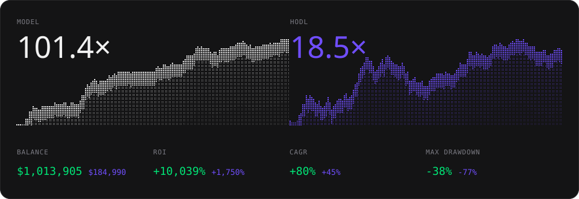
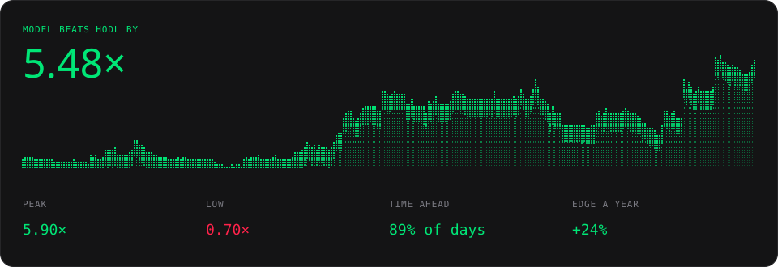
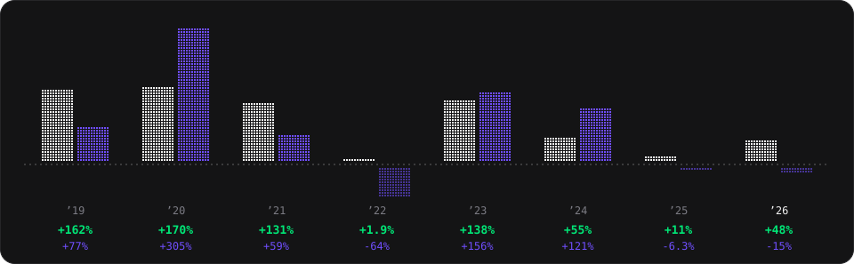
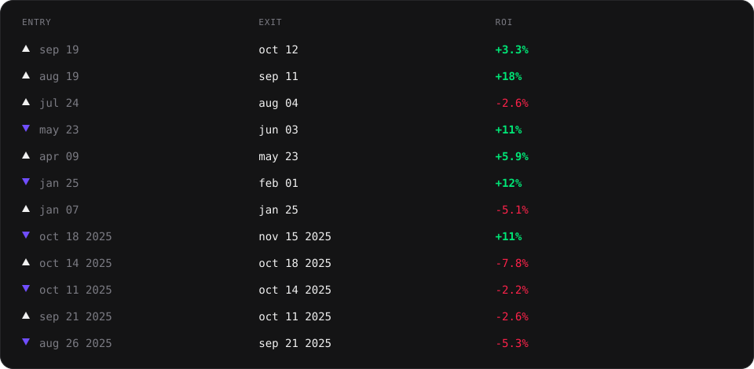

<h1 align="center">BTC 2050 Momentum</h1>

<p align="center">An open-source trading model for Bitcoin that runs in Claude or ChatGPT.</p>

<p align="center">
  <a href="https://tickerdb.com/go/claude/btc-2050-momentum"></a>
  &nbsp;
  <a href="https://tickerdb.com/go/chatgpt/btc-2050-momentum"></a>
</p>

<p align="center">Click a button above, or paste this into Claude in your browser (in ChatGPT, use the button above):</p>

```
Read https://tickerdb.com/run/btc-2050-momentum and follow its steps. Once it's set up, schedule a daily check every day after 06:00 UTC that reads my model link and tells me only if the model bought or sold something.
```

<p align="center">No signup first and no API key to paste: the assistant gives you one link to approve (a free TickerDB account is created there if you are new), then shows you the model's record and checks it for you every day. Each check uses 5 TickerDB credits; the Free plan's 250 credits a month cover one daily check.</p>

<p align="center">
  Data: <a href="https://tickerdb.com">TickerDB</a>. Live record since activation: <a href="https://tickerdb.com/model/btc-2050-momentum">tickerdb.com/model/btc-2050-momentum</a>
</p>

<p align="center">
  
</p>

BTC 2050 Momentum returned +10,039% over the backtest, outperforming HODL's +1,750% and ending 5.5× its result.

## Stats

<p align="center">
  
</p>

| | Model | HODL |
|---|---:|---:|
| Balance from $10,000 | $1,013,905 | $184,990 |
| ROI | +10,039% | +1,750% |
| CAGR | +80% | +45% |
| Max drawdown | -38% | -77% |

From Jan 6, 2019 to Nov 8, 2026, valued at every daily close, after a 0.1% cost each way. HODL is BTC bought at the Jan 6, 2019 close and held.

BTC 2050 Momentum grew faster than HODL (+80% vs +45% a year), with a shallower worst fall (−38% vs −77%).

## Edge

<p align="center">
  
</p>

The model's balance over HODL's, day by day: above 1× it was ahead.

| | |
|---|---:|
| Model beats HODL by | 5.48× |
| Peak | 5.90× (Jun 30, 2026) |
| Low | 0.70× (Apr 20, 2021) |
| Time ahead | 89% of days |
| Edge a year | +24% |

BTC 2050 Momentum beat HODL by 5.5× and was ahead 89% of the time.

## Yearly ROI

<p align="center">
  
</p>

| Year | Model | HODL |
|---|---:|---:|
| 2026 | +48% | -15% |
| 2025 | +11% | -6.3% |
| 2024 | +55% | +121% |
| 2023 | +138% | +156% |
| 2022 | +1.9% | -64% |
| 2021 | +131% | +59% |
| 2020 | +170% | +305% |
| 2019 | +162% | +77% |

The backtest starts on Jan 6, 2019 and ends on Nov 8, 2026, so 2019 and 2026 are part years. BTC 2050 Momentum beat HODL in 5 of 8 years; its best year was 2020 at +170%.

## Trades

<p align="center">
  
</p>

The 12 most recent; all 79 (56 long, 23 short) are in [`results/trades.csv`](results/trades.csv). Returns are after the 0.1% cost each way. BTC 2050 Momentum closed 79 trades: 54% won, and the average trade returned +7.3%.

## Rules

1. **Go long** when BTC closes above a rising 50-day SMA and the 20-day SMA is up at least 0.05% on the day.
2. **Exit** when the 20-day SMA drops at least 0.1% on the day, and **go short** only if BTC is also below its 50-day SMA. Otherwise wait in cash.
3. **Close the short** when it's up 7.5% at a daily close, or when the next buy signal fires.
4. After a take-profit, **stay in cash** until the next buy signal.
5. Signals are checked once a day at the close (00:00 UTC) and filled at the next open, with no leverage.

The parameters are at the top of [`model.py`](model.py).

## Run it yourself

With Claude Code, Codex, Cursor or another agent that runs code on your computer, paste this to clone the model and run it there on a schedule:

```
Clone github.com/tickerdb/btc-2050-momentum and follow its README:
set up TickerDB using tickerdb.com/setup, then schedule run.py to run
every day at 04:30 UTC and tell me when it makes a trade.
```

## How the results are made

The figures above are the model's published record, the same one [its page](https://tickerdb.com/model/btc-2050-momentum) shows: TickerDB runs these rules on its point-in-time data, marks the book at every daily close and publishes the result. [`readme.py`](readme.py) writes this README, its charts and `results/` from that record, and [`backtest.py`](backtest.py) replays the rules from the TickerDB API on its own and must make exactly the record's 79 trades, at the same prices.

```bash
export TICKERDB_API_KEY=tdb_...        # https://tickerdb.com/setup
python backtest.py                     # replays the rules on BTCUSD daily since 2019 (about 90 credits)
python backtest.py --offline           # reruns the replay on the cached data/btcusd_daily.csv
python readme.py                       # fetches the published record and rewrites the README, charts and results/
python readme.py --check               # fails if anything here differs from the record, or the replay's trades do
python run.py                          # today's decision
python -m unittest discover -s tests   # offline tests of the record
```

The replay needs a TickerDB plan with daily history back to 2019 (Pro). No dependencies beyond Python 3.10+.

Point in time: each decision uses only data up to that day's close, and the order fills at the next daily open. The 20- and 50-day SMAs are TickerDB's `trend_ma20_price` and `trend_ma50_price`. A position takes the whole balance at the open it fills; a short is 1x and not rebalanced while it is open.

## Caveats

- **In-sample.** The rules and parameters were tuned on the same 2019–2026 history they're tested on, so expect live results to be weaker.
- **Costs.** 0.1% each way. Shorts pay no funding or borrow fees, and there's no extra slippage.
- **Prices.** Coinbase daily BTC-USD bars from TickerDB, on UTC days.
- **Point in time.** Each decision sees only closes up to that day.
- **Fill timing.** The backtest fills at 00:00 UTC; live, the data arrives at about 04:10 UTC, so live fills come a few hours later.
- **Close-only.** The take-profit is checked at the daily close, not intraday.
- **No stop-loss on shorts.** A sudden squeeze bigger than anything since 2019 would run until the next buy signal.
- Not investment advice. A backtest shows how a model would have done in the past; it doesn’t predict future results.

## License

MIT. The fonts embedded in the README images (Oxanium, Inter, JetBrains Mono, in `assets/fonts/`) are under the SIL Open Font License 1.1.
